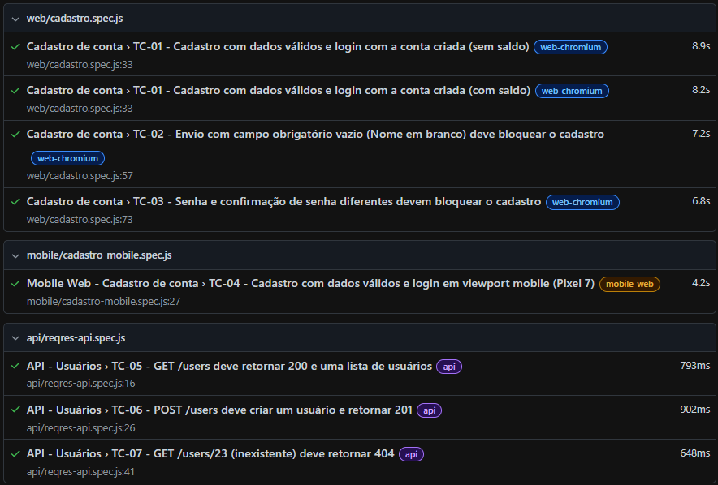

# BugBank Automation — Playwright

[](https://github.com/nandagenu/bugbank-automation-playwright/actions/workflows/tests.yml)

Testes automatizados do [BugBank](https://bugbank.netlify.app), um banco digital fictício para
prática de QA. Os casos de teste foram elaborados por mim em um evento de QA e automatizados
aqui com **Playwright** e **JavaScript**.

## O que é testado

- **Web:** cadastro de conta (dados válidos com e sem saldo, nome em branco, senhas diferentes) e login com a conta criada
- **Mobile web:** o mesmo fluxo de cadastro e login em tela de celular (Pixel 7 emulado)
- **API:** requisições GET e POST em uma API pública, conferindo status code e corpo da resposta

Os casos de teste, com pré-condição, passos e resultado esperado, estão em [`TESTCASES.md`](./TESTCASES.md).

## Estrutura

```
tests/
├── support/bugbank.js              # funções reutilizáveis e seletores
├── web/cadastro.spec.js            # TC-01 a TC-03
├── mobile/cadastro-mobile.spec.js  # TC-04
└── api/reqres-api.spec.js          # TC-05 a TC-07
playwright.config.js                # projetos web, mobile e api, relatórios e evidências
.github/workflows/tests.yml         # CI: roda os testes a cada push
```

## Como rodar

```bash
npm install
npx playwright install chromium
npm test
```

Para abrir o relatório com screenshots e vídeos das falhas: `npm run report`

## Resultado da execução



## Observações

- Os testes de mobile usam emulação de dispositivo no navegador (mobile web). Para app nativo seria necessário o Appium.
- O CI (GitHub Actions) roda os testes a cada push e gera um relatório **JUnit XML** (`results/junit.xml`), o formato que o Xray importa.
